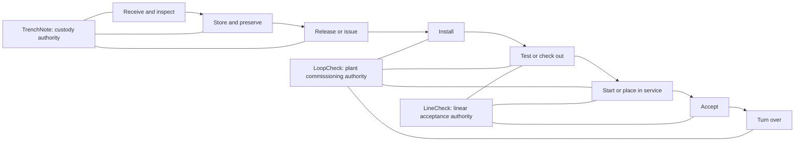

# Ecosystem lifecycle map

**Status: PROPOSED.** This is an ownership and handoff map, not one shared
application, database, or workflow engine. Current deviations are called out
below.

The overlapping boxes are deliberate lifecycle boundaries, not permission to
duplicate authoritative facts. Installation means different things in each
context: TrenchNote may record that a physical item left stock/was consumed;
LoopCheck records whether installed plant equipment passed checkout; LineCheck
records whether installed pipe/service work passed its acceptance sequence.

## Stage ownership and evidence

| Lifecycle stage | Proposed authoritative application | Authoritative fact/evidence | Candidate handoff |
| --- | --- | --- | --- |
| Material/equipment received | TrenchNote | Receipt event, quantity/asset, vendor/PO reference, condition, packing-slip evidence, time/location. | `material.received` or asset reference available to downstream project systems. |
| Inspected at receipt | TrenchNote | Inspection event and delivery exception evidence. | Exception/acceptance reference; do not copy the entire mutable catalog. |
| Stored and preserved | TrenchNote while custody/storage is the concern | Location/custodian movements and preservation inspections. | `asset.released_for_installation` with latest relevant evidence references. |
| Released/issued/consumed | TrenchNote | Append-only movement/consumption event identifying job/destination or installation reference. | Project + asset/material external reference and release event id. |
| Plant equipment installed | LoopCheck | Tag identity plus installation-phase check and punch evidence. | `plant_asset.installation_checked` for startup coordination. |
| Linear infrastructure installed | LineCheck | Segment/service identity and installation/pre-test evidence defined by project requirements. | Test-ready lifecycle event. |
| Plant equipment checked out | LoopCheck | Append-only checks/items, test-equipment references, open blockers, derived phase standing. | `plant_asset.checkout_phase_passed`; consumers retain LoopCheck provenance. |
| Pipeline/service tested | LineCheck | Pressure/gravity tests, readings, calculations, evidence, witnesses, locked snapshots. | `linear_subject.test_accepted` with method/version and evidence references. |
| Started/placed in service | LoopCheck for plant systems; LineCheck for linear/service subjects | Domain-specific startup or clearance evidence. | An explicit event consumed by the neighboring system only when needed. |
| Accepted | Producing domain core | Plant signoff in LoopCheck; segment/service acceptance in LineCheck. | Versioned acceptance event, never inferred by reading another database. |
| Turned over | LoopCheck for plant assets/systems; LineCheck for linear packages | Frozen basic package/index in the core; compiled portfolio/binder may be paid. | Handoff manifest with source record/evidence references. |

## Current deviations

- **CURRENT:** LoopCheck owns and executes service cutover from notice through
  restoration.
- **CURRENT schema/library only:** LoopCheck contains `segments`, segment test
  phases/templates, and open-to-resolve checks.
- **CURRENT sibling direction:** LineCheck is pre-alpha but explicitly owns a
  pressure-test segment vertical slice and plans flushing, disinfection,
  sampling, clearance, and segment packages.
- **UNKNOWN:** No versioned lifecycle-event or handoff-manifest exchange is
  implemented between the local product repositories.

Until migration, LoopCheck remains authoritative for records it already
created. Declaring a future owner does not retroactively move or invalidate
evidence.

## Handoff rules

**PROPOSED:**

1. The producer exports a versioned manifest or lifecycle event over a public
   contract; the consumer never reads the producer's SQLite/PocketBase files.
2. The payload carries stable source identity, project scope, event/export id,
   schema version, timestamps, and evidence references/hashes where available.
3. The consumer stores provenance and a local reference/projection. It does not
   become a second editable master of the source fact.
4. Re-import is idempotent. Correction/supersession arrives as a new event with
   a reference to the prior event.
5. Each application remains independently deployable and usable if every
   neighbor and paid product is absent.

Draft vocabulary is in
[`ecosystem-contracts.md`](ecosystem-contracts.md); it is non-binding.

